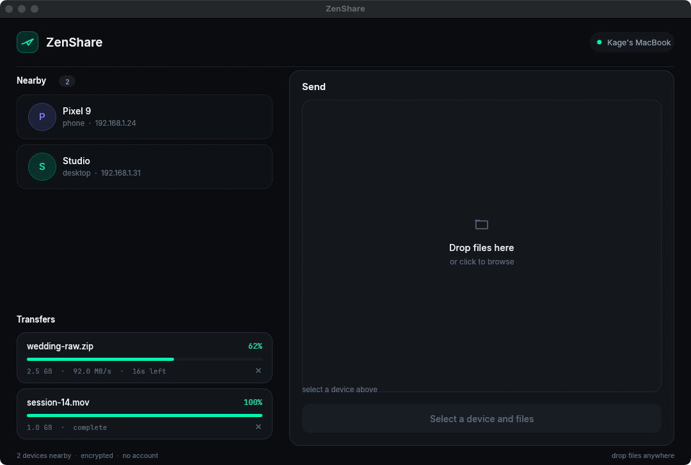

# ZenShare

[](https://github.com/kagesyntax/zenshare/actions/workflows/ci.yml)
[](https://github.com/kagesyntax/zenshare/actions/workflows/release.yml)
[](LICENSE)

Fast, private, cross-platform file transfer. Pure Rust, no webview, no account,
no telemetry, no ads.

> Status: early. The transfer engine works and is verified. The UI is wired to it.
> See [What works](#what-works) for exactly what is and is not done, and
> [docs/PLATFORMS.md](docs/PLATFORMS.md) for what runs where.

## Download

**[Latest release →](https://github.com/kagesyntax/zenshare/releases/latest)** ·
**[Download page](https://kagesyntax.github.io/zenshare/)** (auto-detects your OS)

| macOS | Windows | Linux | Android |
| --- | --- | --- | --- |
| `macos-universal.zip` — Apple Silicon + Intel | `windows-x86_64.zip` — 10 / 11 | `linux-x86_64.tar.gz`, `linux-aarch64.tar.gz` | `android.apk` — arm64, receives only |

These builds are not signed with a paid certificate, so macOS and Windows will
warn you on first launch. [docs/PLATFORMS.md](docs/PLATFORMS.md) has the exact
steps, and says plainly what each platform can and cannot do.



<sub>Demo mode (`--demo`), which fills the window with sample data for design work.</sub>

---

## Why

Xender and its clones are slow, ad-funded, and quietly unencrypted. AirDrop is
excellent but only speaks to Apple devices. Nothing fast and honest exists across
macOS, Windows, Linux and Android.

ZenShare is that tool:

- **Encrypted by default.** QUIC + TLS 1.3 on every transfer. There is no plaintext mode.
- **Verified.** BLAKE3 per 4 MiB chunk, checked before the bytes touch disk.
- **Resumable.** Drop the Wi-Fi at 90% and it picks up from the last chunk, not the start.
- **Fast.** QUIC with BBR and 32 parallel streams, rather than one TCP stream
  that collapses on the first packet loss.
- **Honest.** No account, no cloud, no analytics. The only packets that leave your
  machine go to the device you chose.

## What works

| | |
|---|---|
| Chunked transfer over QUIC | working, verified end to end |
| Per-chunk BLAKE3 verification | working |
| Out-of-order writes + atomic rename | working |
| BBR congestion control | working |
| Peer discovery (UDP multicast) | implemented; **unverified** on hosts that drop multicast |
| Native window, custom-painted UI | working |
| Drag-and-drop file queue | working |
| Send to a discovered peer | working in code, blocked on discovery above |
| Receive into `~/Downloads` | working — a 900 MiB file landed intact |
| Headless send (`zenshare send --to ip:port`) | working |
| 6-digit SAS pairing screen | **not yet** — connects without confirmation |
| Resume after disconnect | **not yet** — protocol field exists, wiring pending |
| QR pairing | **not yet** |
| WAN transfer (iroh) | **not yet** — feature-gated, phase 5 |
| Android | **receives**; sending needs the Storage Access Framework |
| iOS | **not yet** |

## Run it

From a downloaded build, the binary is `zenshare` (inside `ZenShare.app` on
macOS). From source, `cargo run --release --`.

### Prove it works, with one machine

```sh
./zenshare selftest --size-mb 512
```

Generates a payload, pushes it through a real QUIC connection, and compares
BLAKE3 hashes. If this passes, the transfer engine is sound on your machine. It
needs no second device and no network — it is the fastest way to know whether
anything here works.

### Send a real file into the window

```sh
./zenshare                      # in one terminal; prints "listening on <ip>:<port>"
./zenshare send movie.mkv --to 127.0.0.1:<port>
```

The receiver prints its address on startup, so you can drive a full transfer into
the GUI without a second machine. This is the most reliable demo, because it does
not depend on discovery.

### Two devices on one machine

```sh
./zenshare --profile a
./zenshare --profile b
```

Each profile gets its own identity, so they appear to each other as two devices —
**if** your network delivers multicast. Many corporate, guest and sandboxed
networks drop it silently, in which case both windows will say "Looking for
devices…" forever. That is a discovery limitation, not a transfer one; use
`send --to` above to confirm the engine works.

### Everything else

```sh
./zenshare doctor                  # identity, interfaces, downloads dir, QUIC bind
./zenshare --demo                  # populated window with sample data
./zenshare --on-top                # keep the window above everything else
```

`doctor` exits non-zero if something is wrong, so it is safe to use in scripts.

## When devices do not see each other

Discovery is the least reliable part of any LAN tool, including this one. Work
through these in order — the first two account for almost every report.

**1. macOS firewall.** The Application Firewall blocks incoming connections for
unsigned apps, and it does so silently. Check:

```sh
/usr/libexec/ApplicationFirewall/socketfilterfw --listapps | grep -A1 -i zenshare
```

If the entry has no `( Allow incoming connections )` line, it is blocked. Fix it
in System Settings → Network → Firewall → Options: find ZenShare, set it to
*Allow incoming connections*. Or turn the firewall off for the duration of the
test.

**2. Android multicast lock.** Android drops multicast packets unless the app
holds a `WifiManager.MulticastLock`. ZenShare requests one at startup and logs
the result:

```sh
adb logcat -d -s zenshare | grep -i multicast
```

`multicast lock acquired` is what you want. `acquire failed: Java exception was
thrown` means the Wi-Fi service refused — common on emulators, which have no real
Wi-Fi stack, and rare on physical devices.

**3. Access point isolation.** Many guest and corporate networks, and some home
routers with "AP isolation" or "client isolation" enabled, drop traffic between
wireless clients entirely. No amount of application code fixes that. Test by
connecting both devices to a phone hotspot instead.

**4. Prove it is not the protocol.** Two processes on one machine, which does not
touch the firewall or the access point:

```sh
./zenshare peers --seconds 10 --name alpha &
./zenshare peers --seconds 10 --name beta
```

Each should print `HEARD` for the other. CI runs exactly this on every push; if
it passes there and fails on your network, the network is the variable.

## Performance

`selftest` on an x86_64 Mac, loopback, 512 MiB payload, release build:

```
moved          512.0 MiB
elapsed        11s 814ms
throughput     43.3 MiB/s
integrity      ok
```

Honest reading of that number:

- **It is 4–8× a typical Xender transfer**, which is the claim that matters.
- **It is below the 60–110 MiB/s design target**, and the profile says why: of the
  15 s wall time, 18.7 s was *system* time across threads — the cost is in the
  packet and memory path, not in BLAKE3 or TLS. Loopback should be far faster.
- Concrete suspects, in order: macOS has no UDP GSO/GRO (every datagram is its
  own `recvmsg`), the receiver allocates and zeroes a fresh 4 MiB buffer per
  chunk, and the endpoints use default socket buffers because `quinn::Endpoint`
  binds its own socket. All three are fixable without touching the protocol.

Raising `PARALLEL_STREAMS` from 8 to 32 moved this from 30 to 43 MiB/s, which
confirms it is a pipelining problem, not a throughput ceiling.

Loopback is a CPU and syscall benchmark, not a network one. On a real LAN the
link is the limit: 16 MiB socket buffers, 8 MiB per-stream windows, and zero-copy
sends from an mmap'd file.

## How it works

```
┌──────────────┐   UDP multicast    ┌──────────────┐
│   Device A   │◄──────────────────►│   Device B   │
│              │   239.255.42.99    │              │
│  egui UI     │                    │  egui UI     │
│  transfer    │   QUIC / TLS 1.3   │  transfer    │
│  quinn       │◄══════════════════►│  quinn       │
└──────────────┘   8 streams, BBR   └──────────────┘
```

**Discovery.** A 40-byte postcard datagram every two seconds on an
admin-scoped multicast group. Deliberately not mDNS: no DNS parser, no
probe/announce delay, peers appear instantly. Discovery is never trust — anyone
can forge the datagram.

**Session.** QUIC with a freshly minted self-signed certificate per session.
There is no CA, so trust is established out of band: both sides derive six digits
from the two certificate fingerprints and both nonces, and the user compares them.
A man in the middle necessarily holds two different certificates, so the two
sides compute different digits. Six digits, one attempt per session.

**Transfer.** Files are split into 4 MiB chunks, one chunk per QUIC stream, eight
in flight. Each stream carries a fixed 42-byte header — file index, chunk index,
length, BLAKE3 — before the payload, so the receiver verifies with one sequential
read and no round trip. Data lands at absolute offsets in `<name>.zenshare-part`;
only when every chunk is present does it fsync and rename. A half-written file
never appears in your folder.

**No whole-file hash pass.** Chunk boundaries are a pure function of file size, so
if all chunks verify, the file is correct by construction. A 10 GB transfer starts
moving on the first chunk instead of after a 40-second pre-hash.

## Layout

| Crate | Role |
|---|---|
| `zs-core` | types, wire protocol, chunk arithmetic — no I/O, no crypto |
| `zs-crypto` | device identity, SAS derivation, keystore |
| `zs-net` | QUIC endpoint, certificate pinning, multicast discovery |
| `zs-transfer` | sender/receiver pipelines, verification, atomic landing |
| `zs-ui` | egui window, painted from scratch |
| `zs-app` | binary: engine thread + window |

Dependencies point one way only: `zs-app → zs-ui / zs-transfer / zs-net → zs-crypto → zs-core`.

## Dependencies

83 direct runtime crates, one of which has C in it (`ring`, via `rustls`).
Everything else is Rust. See [`docs/CRATES.md`](docs/CRATES.md) for the full
inventory with versions, and [`docs/PLAN.md`](docs/PLAN.md) for the design
decisions behind it.

## License

MIT. See [LICENSE](LICENSE).

Inter and JetBrains Mono are bundled under the SIL Open Font License.
